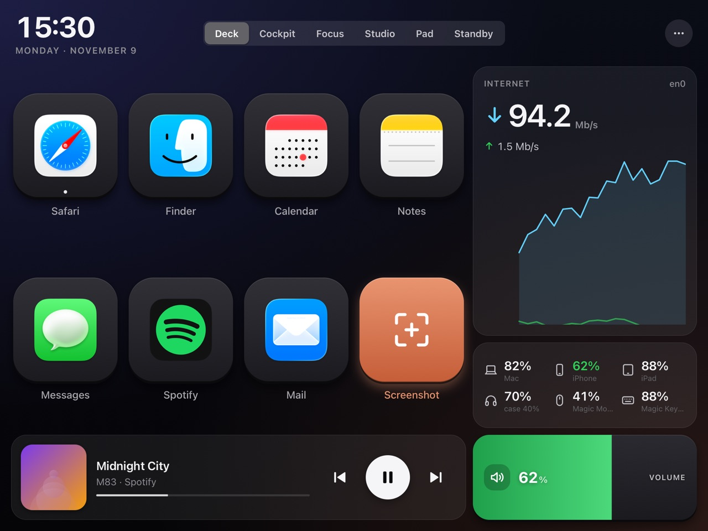
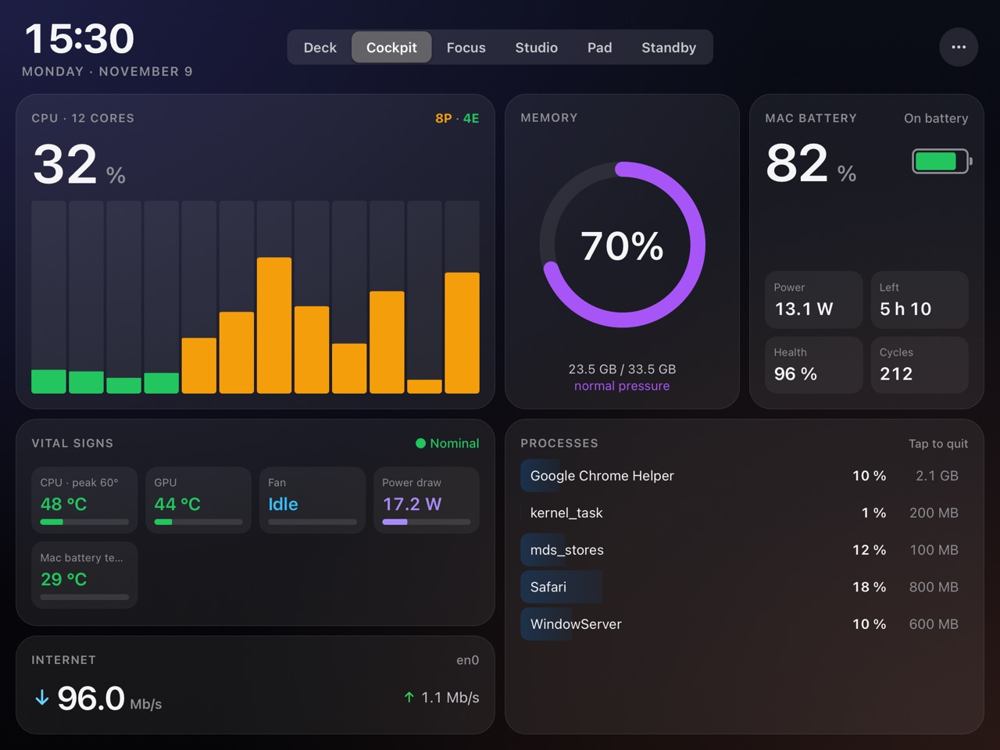
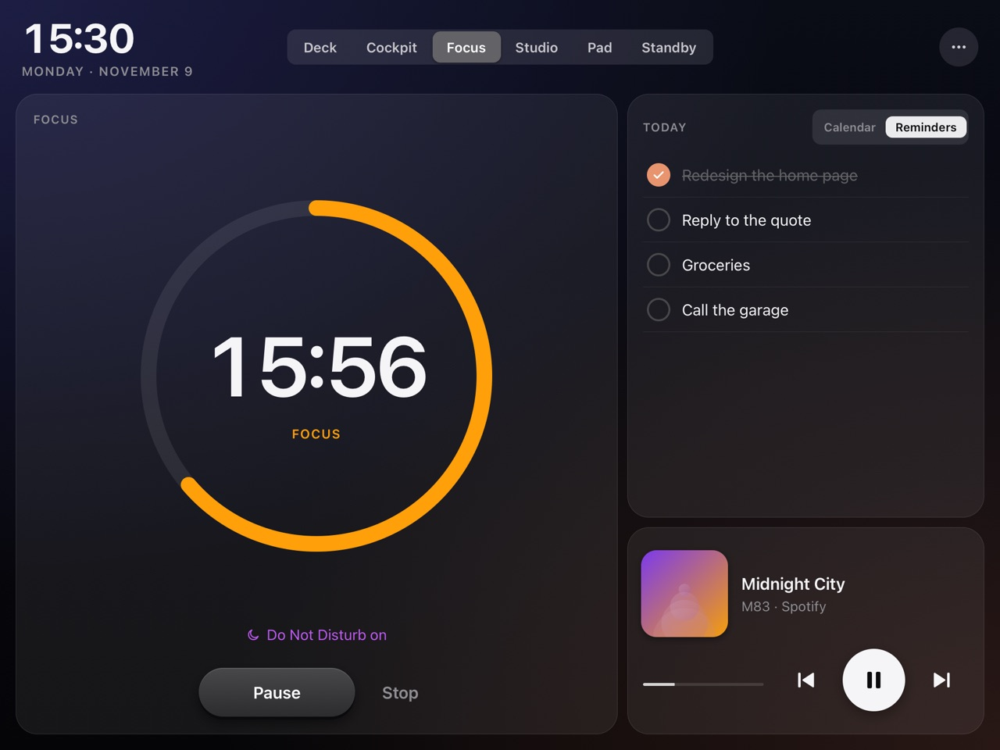

# OldPadDeck

**Give your old iPad a second life as a Stream Deck-style controller and live dashboard for your Mac.**

That iPad stuck on iOS 12 in a drawer still has a great screen. OldPadDeck turns it into a desk companion: keys that launch apps and run Shortcuts, media and volume controls, a trackpad, live CPU / memory / battery gauges, a Pomodoro timer, today's calendar and reminders, a clock and the weather.

Nothing to install on the iPad: a small menu-bar app on the Mac serves the interface to Safari over your home network.

**[Website](https://oldpaddeck.com/) · [Download](https://github.com/n3oraZor/OldPadDeck/releases/latest) · [Install guide](https://oldpaddeck.com/install) · [FAQ](https://oldpaddeck.com/faq)**

| Deck | Cockpit | Focus |
|---|---|---|
|  |  |  |

## Download

Get the latest `OldPadDeck.dmg` from [Releases](https://github.com/n3oraZor/OldPadDeck/releases/latest), open it and drag OldPadDeck to Applications. It's one app for Apple silicon and Intel Macs, signed and notarized by Apple.

- **Mac:** macOS 14 Sonoma or later
- **iPad:** Safari on iOS 12 or later (built for and tested on an iPad Air, 1st generation)
- Both on the same home network

## Feedback

- **Bugs and ideas:** [open an issue](https://github.com/n3oraZor/OldPadDeck/issues/new/choose).
- **Security problems:** please report them privately, see [SECURITY.md](SECURITY.md).

It's a hobby project, tested on one iPad Air: bug reports are very welcome.

## About this repository

This repository holds the website (`docs/`, served by GitHub Pages), the releases and the issue tracker. OldPadDeck itself is free to download and use, but it is not open source: © 2026 n3oraZor, all rights reserved. Third-party components are listed in [THIRD_PARTY_NOTICES.md](THIRD_PARTY_NOTICES.md).

*Inspired by [OldPhoneDeck](https://github.com/GLAUCOMA82/OldPhoneDeck) by GLAUCOMA82. OldPadDeck is a separate implementation written from scratch for the iPad.*

OldPadDeck is an independent project, not affiliated with or endorsed by Apple or Elgato. Mac, macOS, iPad, iOS, Safari and AirPlay are trademarks of Apple Inc.; Stream Deck is a trademark of Corsair Memory, Inc.
